# Chess

A desktop chess game written in Java Swing, with online play through Firebase Firestore.
It has a hand-written rules engine, chess clocks, matchmaking, Elo ratings, a leaderboard
and a game archive where you can replay your old games.

*Originally built in 2025; revisited in 2026 to add ratings, leaderboard, archive/replay, the draw rules and fix rule bugs.*

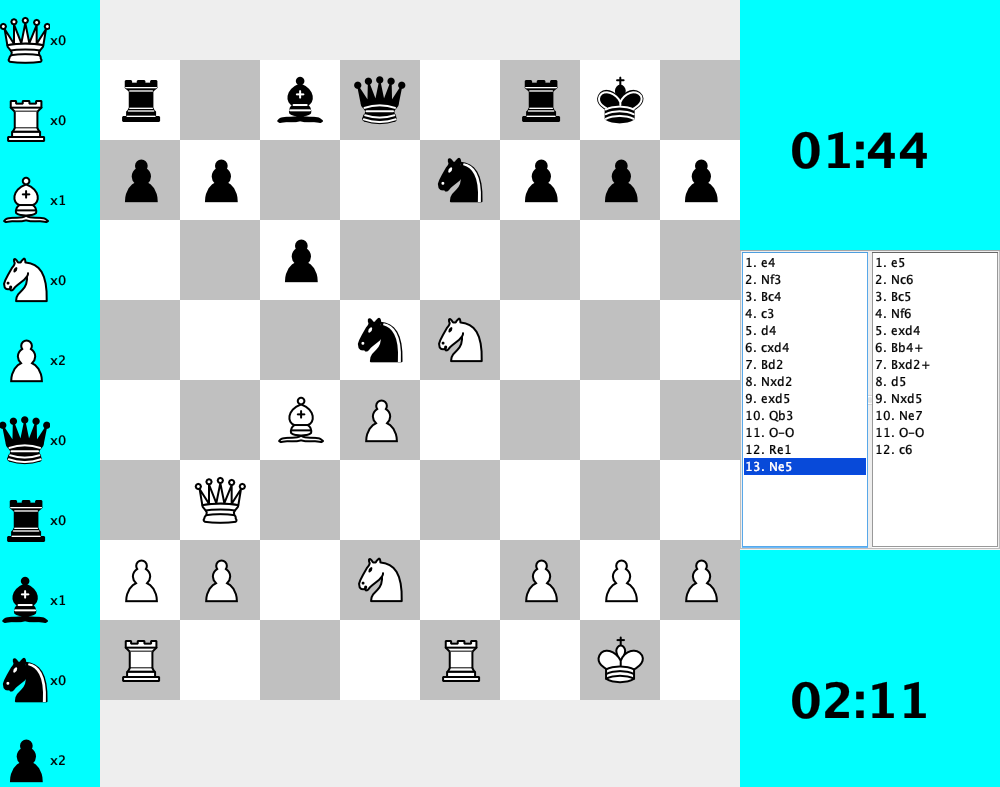

## Features

**Rules engine (written from scratch)**
- Legal move generation for every piece, including pins: a pinned piece cannot leave the line of its king
- Check, checkmate and stalemate detection
- Automatic draws by the **50-move rule**, **threefold repetition** and **insufficient material**
- Castling (king side and queen side, with all the rules: no castling out of, through or into check)
- En passant
- Pawn promotion with a piece picker
- Algebraic move notation (`Nf3`, `exd5`, `O-O`, `cxd8=Q+`, `Qxf7#`)

**Playing**
- Time controls: **1+1, 3+2, 5+3, 10+0** (minutes + seconds added per move)
- Live move list. Click any move to see the board as it was after that move
- Captured-pieces panel
- Legal moves are shown with green circles

**Online**
- Accounts with hashed passwords
- Matchmaking per time control. Players with similar ratings are paired, and colors are random
- Moves are synced between the two players in real time through Firestore
- **Elo rating** that changes after every game (win, loss, draw, timeout or resign)
- **Leaderboard** (top 20), **Profile** (rating, W/L/D, score)
- **Game Archive** with a **replay** viewer (Prev / Next)

## Screenshots

| Log in | Create account | Main menu |
|---|---|---|
| 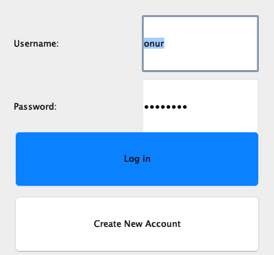 | 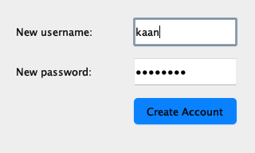 | 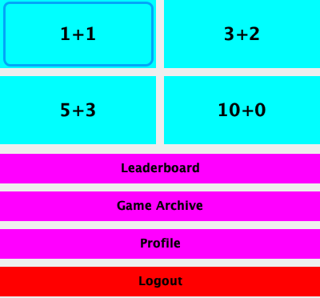 |

| Searching for an opponent | Leaderboard | Profile |
|---|---|---|
| 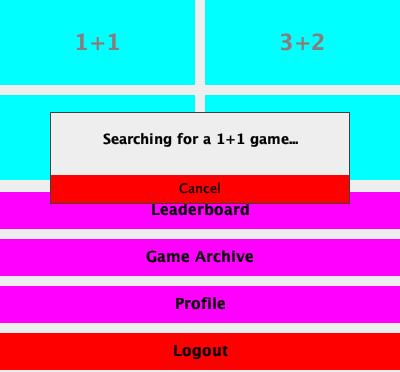 | 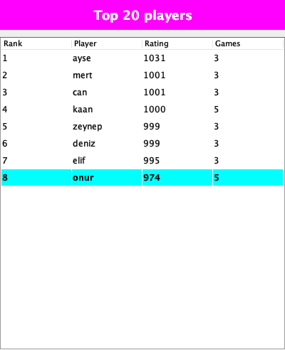 | 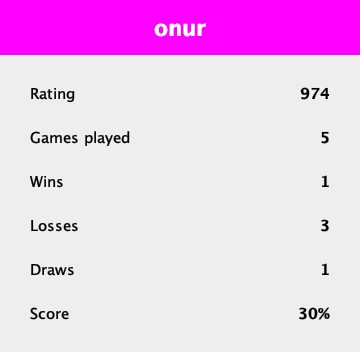 |

| Winning by checkmate (rating updated) | Losing on time |
|---|---|
| 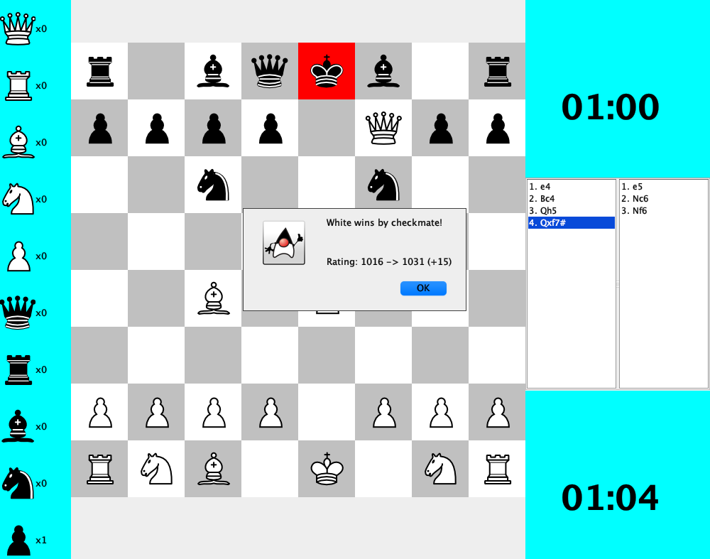 | 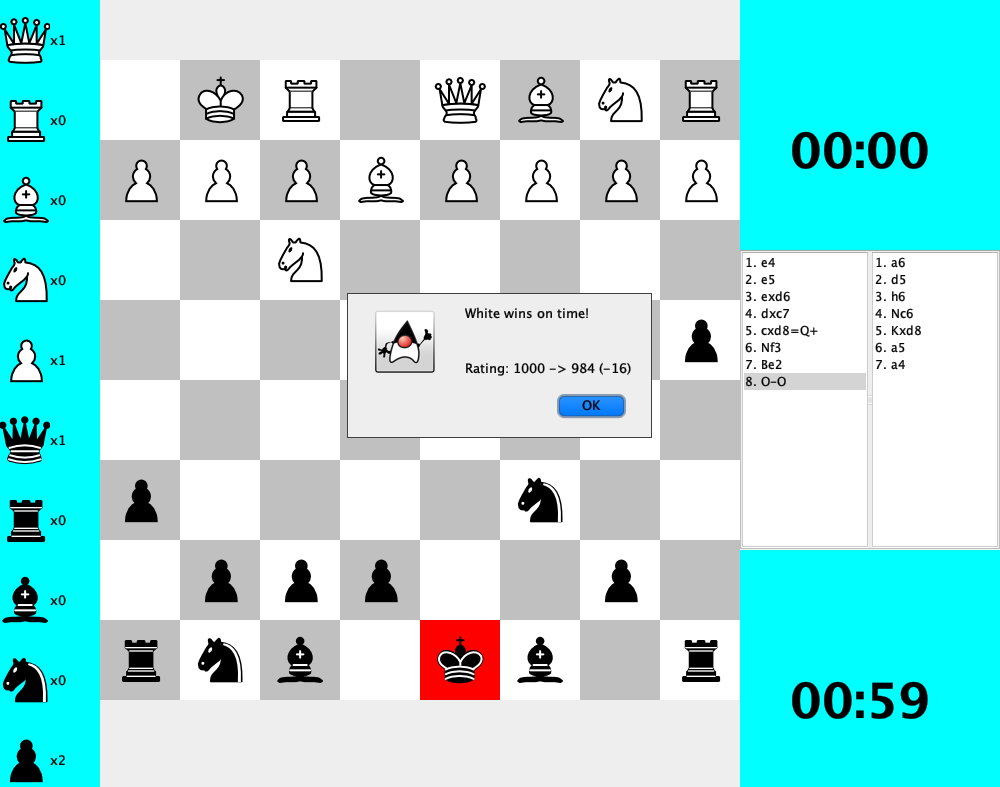 |

| Pawn promotion | Game archive |
|---|---|
| 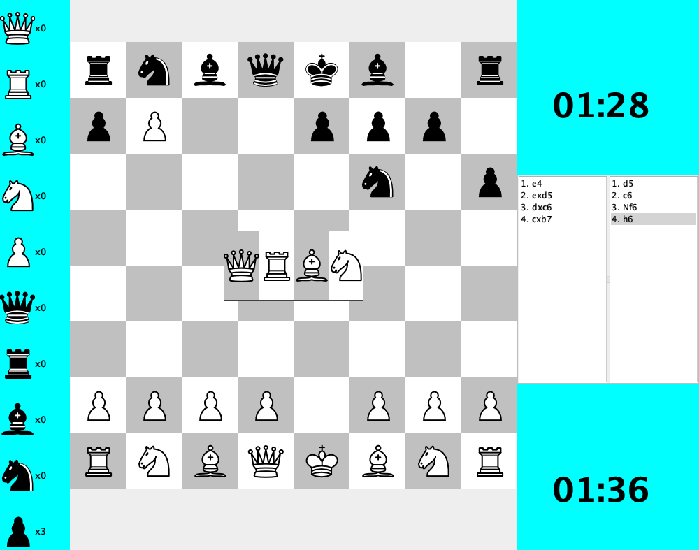 | 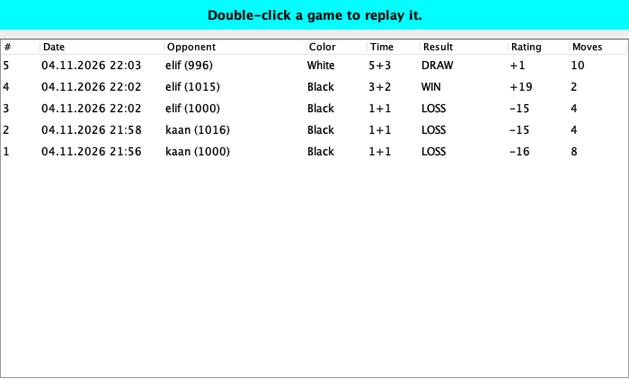 |

| Replaying an archived game (black's view, after `5. cxd8=Q+`) |
|---|
| 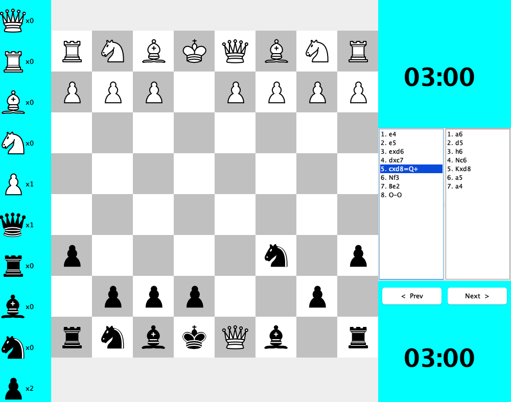 |

## Tech stack

- Java 21, Swing
- Maven
- Firebase Admin SDK / Cloud Firestore

## Getting started

### 1. Requirements
- JDK 21 or newer
- Maven 3.9+

### 2. Set up Firebase
The game needs a Firestore database to store accounts and games.

1. Create a project in the [Firebase console](https://console.firebase.google.com/).
2. Go to **Build → Firestore Database → Create database**.
3. Go to **Project settings → Service accounts → Generate new private key**. This downloads a JSON key file.
4. Save it as `src/main/resources/fireStoreConnectionKey.json`, or put it anywhere and set
   `FIREBASE_KEY_PATH=/path/to/key.json`.

The key file is in `.gitignore`. **Never commit it.** It gives full access to your database.

All collections are created automatically the first time you register and play.

### 3. Run
```bash
mvn compile exec:java
```
To try online play on one computer, start the game twice, log in with two different accounts and pick the same time control in both windows.

## How it works

```
src/main/java
├── Main.java                 entry point
├── Logic/                    rules engine
│   ├── ChessModel.java       move generation, checks, mate, castling, en passant, promotion
│   ├── Index.java            a square (row, column)
│   └── Tempo.java            a clock (time + increment)
├── Pieces/                   Piece and its subclasses (King, Queen, Rook, Bishop, Knight, Pawn)
├── GUI/                      Swing windows (board, menus, leaderboard, profile, archive, replay)
├── ActionListeners/          button and click handlers, matchmaking
├── Online/                   Firestore models and connection, game results and Elo
└── PieceIcons/               icon loading and the move indicator
src/main/resources/PieceIcons piece images
```

**Move legality.** After every move, `ChessModel` first collects each piece's moves
without caring about its own king. It then tries every one of those moves on the board
and drops the ones that would leave the king in check. That one step covers pins,
blocking a check and stepping into check.

**Online games.** Each player has an archive in Firestore (`accounts/{id}/gameArchive/{n}`).
Every client writes every move of the game into its own `moves` collection. Each client
also listens to the opponent's collection and plays any new move on its own board.

**Matchmaking.** Waiting players are put in a queue for their time control. One client at
a time takes a lock document and pairs the queue by rating. It then creates the game in
both players' archives, and each client opens the board as soon as its game appears.

## Roadmap

- Resign and draw-offer buttons in the game window
- Real authentication (Firebase Auth) instead of a service-account key on every client
- Server-side clock so that both players always see exactly the same time
